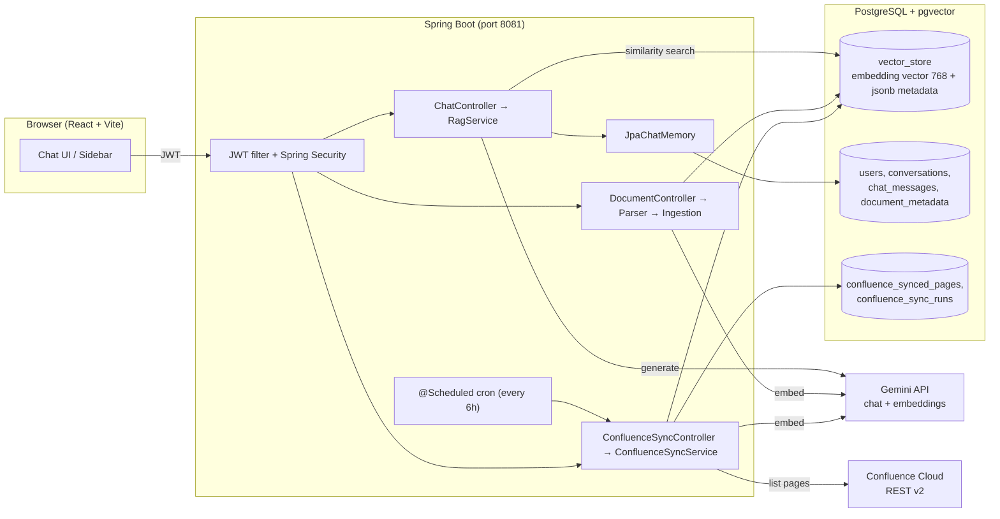
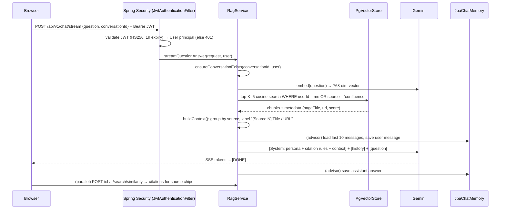
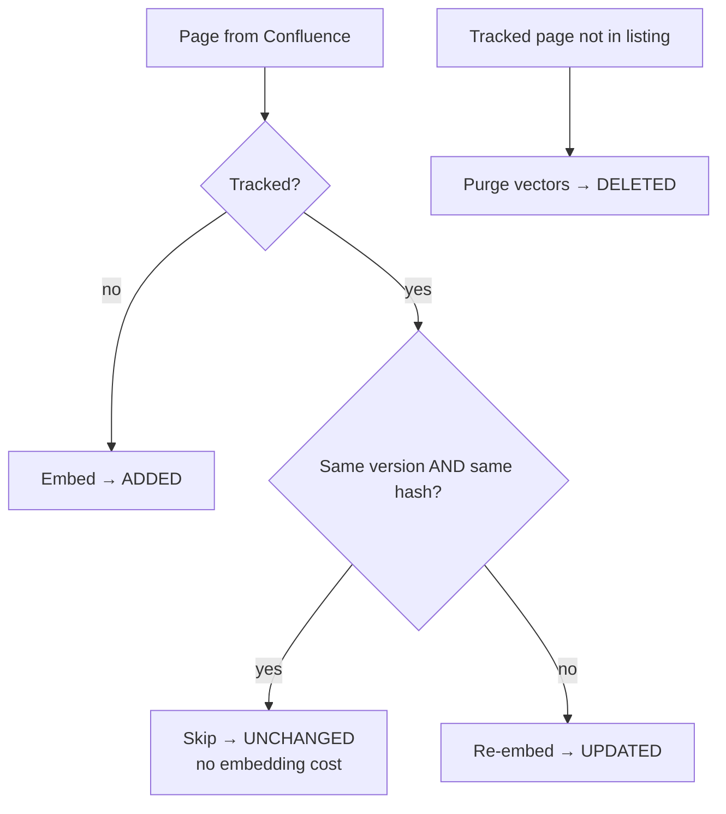

# AetherSync AI — Technical Architecture & Interview Revision Guide

> Revision guide for explaining AetherSync AI (formerly DocMind) in technical interviews.
> Every number and name below is taken from the actual code/config, with file pointers so you can
> re-check anything the night before.

---

## 0. Read this first — facts to get exactly right

Interviewers love catching inconsistencies. These are the places where it's easy to say the wrong thing:

| Topic | Say this | Not this |
|---|---|---|
| Chat model | **`gemini-2.5-flash`** (configurable via `GEMINI_CHAT_MODEL`) | any other model name — check `application-dev.yml` before the interview in case you change it |
| Embedding model | **`gemini-embedding-001`**, output truncated to **768 dims** | "Gemini 2.5 Flash makes the embeddings" (it's a chat model; it can't) |
| Frontend | **React 19 + Vite + Tailwind CSS v4 + Zustand** (single-page app) | "Next.js" — there is no SSR/App Router in this project |
| "Hybrid" | Hybrid **sources** (uploads + Confluence) in one **vector** search | "Hybrid search" in the BM25 + vector sense — there is no keyword search (good "future work" answer) |
| Vector index | **HNSW**, **cosine distance**, inside PostgreSQL via **pgvector** | a separate vector DB |
| Package name | Code still lives in `com.substring.docmind` (rename kept for compatibility) | — |

---

## 1. Executive Summary & High-Level Architecture

### 1.1 The 30-second pitch

> "AetherSync AI is a retrieval-augmented assistant for engineering teams. It continuously syncs a
> Confluence space into PostgreSQL with pgvector, lets each user add their own private documents, and
> answers questions with Gemini — every answer cites clickable links back to the Confluence pages it
> used, and can include live Mermaid diagrams. The interesting engineering is in the incremental sync:
> it only re-embeds pages whose version or content hash changed, writes new chunks before deleting old
> ones so pages are never unsearchable, and refuses to purge anything unless it got a complete listing
> from Confluence."

### 1.2 What problem it solves
- Team knowledge lives in Confluence, but searching it is keyword-based and answers are scattered.
- RAG grounds the LLM in **your** documentation, reducing hallucination, and **citations** let users verify.
- Personal uploads (PDF, DOCX, TXT, MD, CSV) cover documents that aren't in Confluence, **isolated per user**.

### 1.3 Tech stack

| Layer | Technology | Notes |
|---|---|---|
| Backend | Java 21, **Spring Boot 4.1**, Spring Security (stateless JWT), Spring Data JPA | `pom.xml` |
| AI framework | **Spring AI 2.0** (`ChatClient`, advisors, `VectorStore`, `TokenTextSplitter`) | |
| LLM | Google **Gemini `gemini-2.5-flash`** via `spring-ai-starter-model-google-genai`, temperature 0.2 | |
| Embeddings | **`gemini-embedding-001`**, `dimensions: 768` (separate embedding client & API-key property) | |
| Vector store | **PostgreSQL 16 + pgvector** (`pgvector/pgvector:pg16` Docker image), Spring AI `PgVectorStore` | |
| Parsing | Apache **Tika** (generic files), Spring AI **PDF reader** (page-wise), **jsoup** (Confluence XHTML) | |
| External source | **Confluence Cloud REST API v2**, Basic auth (email + API token) | |
| Frontend | **React 19 + Vite + Tailwind v4**, Zustand, react-markdown + remark-gfm, **mermaid 11** | |

### 1.4 Architecture diagram



### 1.5 Request lifecycle: user prompt → answer



Key files: `controller/ChatController.java`, `service/RagService.java`, `config/ProjectConfig.java` (system prompt), `config/SecurityConfig.java`.

---

## 2. Confluence Ingestion & Synchronization Pipeline (Deep Dive)

Code: `service/confluence/` — `ConfluenceClient`, `ConfluenceContentConverter`, `ConfluenceSyncService`;
`controller/ConfluenceSyncController`; entities `ConfluenceSyncedPage`, `ConfluenceSyncRun`.

### 2.1 Trigger mechanisms

| Trigger | How | Details |
|---|---|---|
| **Scheduled** | `@EnableScheduling` on the app class + `@Scheduled(cron = "${confluence.sync.cron:0 0 */6 * * *}")` | Every 6 hours by default (Spring cron has **6 fields**: sec min hour day month weekday). Skipped if `CONFLUENCE_SYNC_ENABLED=false` or credentials missing. |
| **Manual** | `POST /api/sync/confluence` | `@PreAuthorize("hasRole('ADMIN')")`. Returns **202 Accepted** with the run record immediately; work happens in the background. |
| **Startup** | `ApplicationReadyEvent` listener | Optional (`CONFLUENCE_SYNC_ON_STARTUP`). Also marks any run left `RUNNING` by a crash as `FAILED`. |

**Concurrency control:** an `AtomicBoolean running` with `compareAndSet(false, true)` guarantees one run
at a time; a second trigger gets **409 Conflict**. Runs execute on a **dedicated single-thread executor**
(`confluence-sync` daemon thread), not the HTTP thread and not Spring's shared task executor.

Status/observability endpoints (any signed-in user): `GET /api/sync/confluence/status`, `/runs`,
`/runs/{id}`, `/pages`. Each run row stores counts (`scanned/added/updated/unchanged/deleted/failed`,
`chunksWritten`), timing, trigger type, who triggered it, and an error log. Progress is persisted every 10 pages.

### 2.2 API fetching & pagination

1. `GET {base}/api/v2/spaces?keys=MFS&limit=1` → resolve the numeric **space id** (v2 endpoints use ids, not keys).
2. `GET {base}/api/v2/spaces/{id}/pages?status=current&body-format=storage&limit=100`
   - `status=current` → only **published** pages (drafts/archived/trashed excluded).
   - `body-format=storage` → the page body comes in the same call (no N+1 requests per page).
3. **Cursor pagination:** follow `_links.next` until absent. The `next` link is *relative to the site
   origin* (`/wiki/api/v2/...?cursor=...`) and **already URL-encoded** — it's passed as a `URI` so the
   cursor isn't double-encoded (there's a test for exactly this).
4. Web URL for citations = `_links.base` + page `_links.webui`
   (e.g. `https://vector11.atlassian.net/wiki/spaces/MFS/pages/123/Title`), with a fallback built from the base URL.

**Resilience (`ConfluenceClient.withRetry`):**

| Response | Behaviour |
|---|---|
| 401 / 403 | **No retry** — fail fast with an actionable message (check token/permissions). Retrying bad credentials just burns time and can lock accounts. |
| 429 Too Many Requests | Retry, honouring **`Retry-After`** (capped at 60 s) |
| 5xx / network errors | Retry with **exponential backoff**: 1 s → 2 s → 4 s … capped at 30 s |
| Attempts | max **4** attempts, then `ConfluenceApiException` |

HTTP client: Spring `RestClient` on the JDK `HttpClient` with connect/read timeouts (10 s / 60 s), Basic auth header.

### 2.3 Smart incremental sync & versioning

Tracking table **`confluence_synced_pages`**:

| Column | Purpose |
|---|---|
| `page_id` (PK) | Confluence page id |
| `title`, `space_key`, `web_url` | Display + citation |
| `version_number` | Confluence version at last successful embed |
| `content_hash` | **SHA-256(title + "\n" + storage body)** |
| `chunk_count`, `last_synced_at` | Observability |

Decision per page:



- **Why both version and hash?** Version catches normal edits cheaply; the hash catches changes that
  don't bump the version and protects against trusting a single signal. Title is in the hash because
  the title is embedded into chunk text and shown in citations.
- **Cost impact:** in steady state almost every page is `UNCHANGED`, so a 6-hourly sync costs one
  listing call per 100 pages and **zero embedding calls**. (Verified: a second run reported `chunksWritten=0`.)
- **Failure handling:** if a page fails to embed, its tracking row is **not** updated → it is retried automatically next run.

### 2.4 Parsing & chunking

**Storage format → Markdown** (`ConfluenceContentConverter`, jsoup in XML mode):
- Headings → `#`, lists (nested, ordered/unordered) → `-` / `1.`, tables → Markdown tables, links → `[text](href)`.
- `code` macro → fenced block with its `language` parameter; any macro whose name contains `mermaid` → ```` ```mermaid ````
  (so diagrams stored in Confluence survive and can be re-rendered).
- Callouts (`info/note/warning/tip/panel/expand`) → `> **Warning:** …`.
- Noise removed: macro parameters, images, emoticons, user mentions, macros without text (toc, children…).
- **Why Markdown instead of plain text?** Structure carries meaning (a table row, a code block) — it chunks better,
  embeds better, and the LLM can quote it accurately.

**Chunking:** Spring AI `TokenTextSplitter` (token-based, not character-based):

| Setting | Value (from `app.rag` config / `AppProperties`) |
|---|---|
| `chunkSize` | **700 tokens** |
| `minChunkSizeChars` | 350 |
| `minChunkLengthToEmbed` | 5 |
| `maxNumChunks` | 10,000 |
| `keepSeparator` | true |

The page title is prepended (`# Title`) before splitting so every page has a strong topical anchor.

**Metadata on every Confluence chunk** (stored in the jsonb `metadata` column):
`source="confluence"`, `pageId`, `pageTitle`, `spaceKey`, `url` (absolute web UI URL), `pageVersion`,
`chunkIndex`, `totalChunks`, **`syncId`** (UUID per ingest), and `fileName` (= title, for UI compatibility).

### 2.5 Safe upserts & deletion handling

**Write-then-delete (blue/green per page):**
1. Generate a new `syncId` for this ingest.
2. `vectorStore.add(newChunks)` — embeds and inserts.
3. Only then: `DELETE … WHERE source='confluence' AND pageId=X AND syncId != newSyncId`.

If step 2 fails (Gemini quota, network), the old chunks are still there → **the page never becomes
unsearchable**. Delete-first would leave a window (or permanent gap on failure) with no content.

Generated SQL (pgvector filter → JSONPath), verified against a real database:
```sql
DELETE FROM vector_store
WHERE metadata::jsonb @@ '$."source" == "confluence" && $."pageId" == "101" && $."syncId" != "keep-me"'::jsonpath;
```

**Deleted pages & outage safety:**
- Pages tracked in the DB but absent from the listing are purged (vectors + tracking row).
- This step runs **only after a complete, successful listing.** If listing throws halfway (outage, 503, auth),
  the run is marked `FAILED` and **nothing is purged** — otherwise "Confluence returned 0 pages" would wipe the index.

**Run status:** `SUCCESS`, `PARTIAL_SUCCESS` (some pages failed), `FAILED` (listing failed or everything failed).

---

## 3. Vector Search, Storage & pgvector

### 3.1 Embeddings
- Each chunk's text → **`gemini-embedding-001`** → float vector. The model natively produces **3072** dims; we
  request `outputDimensionality = 768` (Matryoshka-style truncation supported by the model).
- **Why 768?** pgvector's HNSW index supports at most **2,000 dimensions** for the `vector` type, so 3072 can't be
  indexed with HNSW. 768 also means ~4× less storage and faster distance math, with small quality loss.
- **Dimension contract:** the table column is `vector(768)`. If you ever change the embedding model/dimension
  you must recreate the table and **re-embed everything** — vectors from different models aren't comparable.
- Same model embeds documents and queries (required for meaningful similarity).

### 3.2 Schema

```sql
-- Created by Spring AI PgVectorStore (initialize-schema: true)
CREATE TABLE vector_store (
  id        uuid PRIMARY KEY,
  content   text,          -- chunk text
  metadata  jsonb,         -- source, userId/documentId or pageId/url/syncId, chunkIndex, ...
  embedding vector(768)
);
CREATE INDEX spring_ai_vector_index ON vector_store USING hnsw (embedding vector_cosine_ops);
```

Relational tables (JPA, `ddl-auto: update`): `users`, `document_metadata` (upload status
`UPLOADING → PROCESSING → INDEXED / FAILED`), `conversations`, `chat_messages`,
`confluence_synced_pages`, `confluence_sync_runs`.

Search: `ORDER BY embedding <=> :query` (cosine distance), `similarity = 1 − distance`, **top-K = 5**,
similarity threshold 0.0 (i.e. disabled — always return the top 5).

**HNSW vs IVFFlat (know this):** HNSW = graph index, better recall/latency, no training step, slower to build and
more memory; IVFFlat = clustered lists, needs data before building, faster to build. HNSW fits a knowledge base
that grows incrementally.

### 3.3 Isolation & scoping

| Request | Filter |
|---|---|
| No document selected | `userId == <me> OR source == 'confluence'` → my uploads + shared Confluence |
| A document selected | `userId == <me> AND documentId == <doc>` → that upload only |

```sql
WHERE metadata::jsonb @@ '$."userId" == "7" || $."source" == "confluence"'::jsonpath
```

- Uploaded chunks carry `userId` and `documentId`; Confluence chunks carry **no `userId`**, so they can never
  match another user's upload filter. Verified: user 7 sees their uploads + Confluence, never user 8's uploads.
- `userId` comes from the **JWT-authenticated principal**, never from the request body → users can't spoof it.
- Honest caveat: everyone sees **all** synced Confluence pages — the visible set equals what the **sync account**
  can read. Confluence page restrictions aren't mirrored per user (see §7).

---

## 4. Chat Memory & Context Management

### 4.1 Persistent conversation history (`service/JpaChatMemory.java`)
- Implements Spring AI's **`ChatMemory`** interface → Spring AI's default in-memory memory backs off; ours is used.
- Tables: `conversations(id = client-generated UUID, user_id, title, created_at, updated_at)` and
  `chat_messages(id, conversation_id FK, message_type USER|ASSISTANT|SYSTEM, content TEXT, created_at)`.
- `get(conversationId)` → native query `ORDER BY created_at DESC LIMIT 10`, then re-sorted ascending →
  a **sliding window of the last 10 messages** (~5 exchanges). Bounds prompt size and cost.
- `add(...)` → maps Spring AI messages to rows and bumps `updated_at`.
- **Ownership:** `RagService.ensureConversationExists` looks up `findByIdAndUser(conversationId, user)` and creates
  the conversation for that user on first message (title = first 50 chars of the question).

### 4.2 Context injection — what Gemini actually receives
Wired in `ProjectConfig`: `ChatClient` with `defaultSystem(...)` and `MessageChatMemoryAdvisor` + `SimpleLoggerAdvisor`.

```
[System]   Persona ("You are AetherSync AI…") + citation rules + Mermaid rules
           + "Knowledge base context:" {doc_context}   ← retrieved chunks
[History]  last ≤10 messages from JpaChatMemory        ← MessageChatMemoryAdvisor
[User]     current question
```

- `{doc_context}` is a Spring AI template variable filled per request with `.system(s -> s.param("doc_context", ...))`.
  Gotcha: the template engine uses `{ }` — the system prompt must not contain other braces.
- **Context format** built by `RagService.buildContext`: each chunk is labelled
  `[Source N]`, `Title:`, `Type: Confluence page | Uploaded document (page p)`, `URL:`, `Content:`.
  Chunks from the same page share the same N, and the UI's chip numbers use the same N.
- **Citation rules** in the prompt: cite with Markdown links using the **exact URL from the context**, never invent
  or modify URLs, don't cite unused sources. Grounding + verifiability.
- Advisor ordering detail: the memory advisor saves the **user message before** calling the model and the
  **assistant message after**; for streaming it aggregates the stream first. (If Gemini fails, the question is
  stored without an answer — a known edge case.)

---

## 5. Frontend & UI Features (React + Vite + Tailwind)

### 5.1 Aesthetic
- `#0A0A0A` background, `#161616` cards, `#2FFF88` neon accent.
- Implemented centrally with **Tailwind v4 `@theme`**: a custom `neon-*` scale and an override of the `slate-*`
  scale to neutral blacks — one place to retheme instead of editing hundreds of classes.
- Accessibility detail: white text on neon green fails contrast → solid neon surfaces use **black** text.

### 5.2 Clickable source citations
- Backend returns `citations` (one per chunk: `sourceType`, `sourceTitle`, `sourceUrl`, `pageId`, score, snippet)
  and `sources` (deduplicated per page).
- `utils/sources.ts → deriveSources()` groups citations by URL (or documentId) client-side — so chips also work for
  chats saved before the feature existed. `SourceChips.tsx` renders numbered chips: book icon + title + external-link icon,
  opening Confluence in a new tab (`rel="noopener noreferrer"`).
- **Security:** `safeHttpUrl()` only allows `http(s)` URLs (blocks `javascript:` links). react-markdown also sanitises links in the answer.
- In streaming mode, citations come from a parallel `/chat/search/similarity` call (same query + filter → same chunks).

### 5.3 Live Mermaid rendering (`components/MermaidDiagram.tsx`)
- react-markdown's `code` renderer routes ```` ```mermaid ```` blocks to `<MermaidDiagram>`.
- **Lazy loaded:** `import('mermaid')` on first diagram → separate chunks; not in the main bundle.
- **Safe:** `securityLevel: 'strict'` (sanitised SVG, no click handlers/scripts); `mermaid.parse()` before `render()`
  so invalid input never injects mermaid's error graphic into the page.
- **Streaming-friendly:** while tokens arrive the fence is incomplete → parse fails → we keep the **last good diagram**
  and re-render (debounced 250 ms) as more arrives. Errors are shown only once streaming has finished.
- Interactive: zoom (buttons / Ctrl+wheel), fullscreen modal, view & copy source. Themed to the neon palette.
- **Performance fix worth mentioning:** react-markdown treats each `components` entry as a component *type*; defining
  them inline re-creates them every render → every streamed token **remounted** every code block/diagram.
  Moved to a module-level map + React Context for the streaming flag.

### 5.4 Streaming & session handling
- `fetch` + `ReadableStream` parses SSE `data:` lines, throttled UI updates (35 ms), stop button via `AbortController`.
- Expired JWT → backend **401** → frontend clears the token (but **keeps local chat history**) and redirects to
  `/login?expired=1`; expired tokens are also detected on page load by decoding the JWT `exp`.

---

## 6. Interview Q&A Cheatsheet

**Q1. How do you handle stale vectors when a Confluence page is deleted?**
> Every run lists all published pages and diffs them against `confluence_synced_pages`. Tracked pages missing from
> the listing are purged with a metadata filter (`source='confluence' AND pageId=X`) and their tracking row removed.
> Crucially, the purge only runs after a *complete* listing — if Confluence errors mid-pagination the run fails
> without deleting anything, so an outage can't wipe the index. Archived/unpublished pages are treated as deleted
> because we only list `status=current`.

**Q2. Why pgvector instead of a managed vector DB (Pinecone, Weaviate…)?**
> Our scale is thousands to low millions of chunks, which pgvector with HNSW handles well. Keeping vectors next to
> relational data gives us one system to run, back up and secure; metadata filtering with JSONB; and transactional
> consistency with tracking tables. No extra vendor, network hop, or data-sync problem between two stores. I'd revisit
> at tens of millions of vectors, very high QPS, or if we needed advanced hybrid search out of the box. Spring AI's
> `VectorStore` abstraction keeps that migration cheap.

**Q3. How do you prevent race conditions during sync runs?**
> Within a node: an `AtomicBoolean` with compare-and-set means only one run starts; others get 409, and scheduled
> runs just skip. Runs execute on a single-thread executor. Per page, the write-then-delete with a unique `syncId`
> makes re-processing idempotent. On startup, runs left `RUNNING` by a crash are marked `FAILED`.
> Limitation: the lock is **in-memory** — with multiple instances I'd use a distributed lock (ShedLock or a Postgres
> advisory lock `pg_try_advisory_lock`), or run sync as a single worker.

**Q4. How do you avoid re-embedding (and paying for) unchanged content?**
> Version number + SHA-256 of title and body stored per page. Unchanged pages are skipped before any embedding call.
> A second consecutive run produces zero embeddings. Failed pages keep their old tracking row so they retry next time.

**Q5. How is user data isolated when Confluence content is shared?**
> Every uploaded chunk carries `userId` from the authenticated JWT principal; Confluence chunks carry `source=confluence`
> and no `userId`. Search filter is `userId == me OR source == confluence`, or `userId == me AND documentId == X` when
> scoped. The filter is built server-side, never from client input. Caveat: Confluence visibility = sync account's
> visibility; per-user Confluence permissions would need permission metadata per chunk or a query-time check.

**Q6. How do you keep the LLM from inventing citations?**
> Context entries carry explicit `[Source N]`, title and URL; the system prompt says to cite only URLs that appear
> verbatim, never modify them, and not cite unused sources. Independently of the model, the UI renders source chips
> from **retrieval metadata**, not from the model's text — so the chips are always real pages. Temperature is 0.2.

**Q7. Why 768 dimensions?**
> pgvector HNSW indexes cap at 2,000 dims; gemini-embedding-001's native 3072 can't be HNSW-indexed. It supports
> truncated output, so 768 keeps strong quality with ~4× less storage and faster search. Changing it requires re-embedding.

**Q8. What happens if embedding fails halfway through a page update?**
> New chunks are written before old ones are deleted, so the old version stays searchable. The page counts as failed,
> the run becomes `PARTIAL_SUCCESS`, the tracking row is untouched, and the next run retries it.

**Q9. How does streaming interact with authentication?** *(great "bug I fixed" story)*
> SSE responses complete on an async servlet dispatch. Our JWT filter is once-per-request, so it doesn't run again on
> that dispatch. We also save the `SecurityContext` in `RequestAttributeSecurityContextRepository` so the async and error
> dispatches stay authenticated. Before that, the JWT filter wasn't even in the security chain at all — routes had been
> made `permitAll` to compensate, which caused null-principal crashes with expired tokens. Fixed by
> `addFilterBefore(...)`, a 401 entry point, and frontend session-expiry handling.

**Q10. Pagination/rate limits on Confluence?**
> Cursor pagination via `_links.next` (passed as a pre-encoded URI). 429 honours `Retry-After`; 5xx/timeouts use
> exponential backoff (1 s, doubling, capped 30 s, max 4 attempts); 401/403 fail fast. Bodies come in the list call
> (`body-format=storage`) — no per-page N+1.

---

## 7. Known limitations & what I'd improve next (say these proactively)

| Area | Current | Improvement |
|---|---|---|
| Retrieval | Pure vector top-5, no threshold | **Hybrid search** (Postgres full-text/BM25 + vector, Reciprocal Rank Fusion), re-ranking, similarity threshold |
| Filtered HNSW | Filter applied with the HNSW scan; restrictive filters can return < K results | Raise `hnsw.ef_search`, pgvector iterative index scans, partial/per-tenant indexes, GIN index on metadata |
| Confluence permissions | All users see all synced pages | Store space/page restrictions per chunk; filter by user's groups |
| Sync lock | In-memory `AtomicBoolean` | ShedLock / Postgres advisory lock for multi-instance |
| Change detection | Full listing every run | Confluence webhooks or `lastModified` sorting for near-real-time sync |
| Content coverage | Page bodies only | Attachments (via Tika), comments, multiple spaces |
| Memory | Last 10 messages, verbatim | Summarise older turns; token-budget-based window |
| Auth | 1-hour JWT, no refresh | Refresh tokens / "remember me" |
| Schema | `ddl-auto: update` | Flyway/Liquibase migrations |
| Evaluation | Manual | RAG eval set (retrieval hit-rate, answer faithfulness, citation accuracy) |

---

## 8. Numbers to memorise

| What | Value |
|---|---|
| Embedding dims | 768 (native 3072; HNSW limit 2000) |
| Chunk size | 700 tokens (min 350 chars) |
| Top-K | 5 |
| Distance / index | Cosine / HNSW |
| Chat memory window | last 10 messages |
| Sync schedule | `0 0 */6 * * *` (every 6 h) |
| Confluence page size | 100 per request (API max 250) |
| Retries | 4 attempts, 1 s → 30 s cap, `Retry-After` ≤ 60 s |
| JWT lifetime | 1 hour (HS256) |
| Upload limits | 25 MB/file, 50 MB/request |
| LLM temperature | 0.2 |

## 9. File map (for quick re-checking)

| Concern | File |
|---|---|
| RAG orchestration, filters, context, citations | `src/main/java/.../service/RagService.java` |
| System prompt, ChatClient, advisors | `.../config/ProjectConfig.java` |
| Chat memory | `.../service/JpaChatMemory.java`, `repository/ChatMessageRepository.java` |
| Confluence sync | `.../service/confluence/ConfluenceSyncService.java` |
| Confluence HTTP client | `.../service/confluence/ConfluenceClient.java` |
| XHTML → Markdown | `.../service/confluence/ConfluenceContentConverter.java` |
| Upload pipeline | `.../service/DocumentParserService.java`, `DocumentIngestionService.java` |
| Security / JWT | `.../config/SecurityConfig.java`, `JwtAuthenticationFilter.java` |
| Config | `src/main/resources/application-dev.yml` |
| Tests | `src/test/java/.../service/confluence/*Test.java` (13 tests) |
| Chat UI, Markdown, streaming | `frontend/docmind-frontend/src/components/ChatView.tsx` |
| Mermaid / citations | `components/MermaidDiagram.tsx`, `components/SourceChips.tsx`, `utils/sources.ts` |
| Operations guide | `docs/CONFLUENCE_SYNC.md` |
